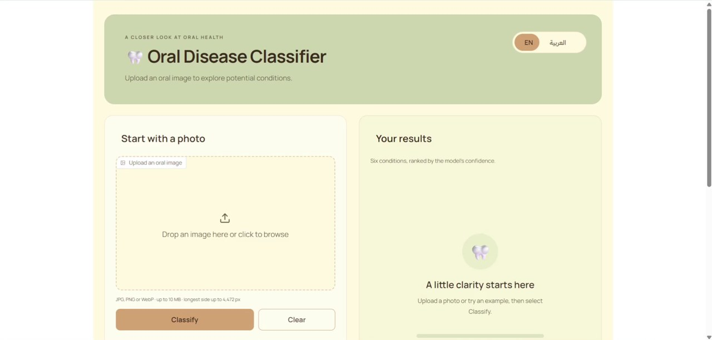

# 🦷 Oral Disease Image Classification

<p align="center">
  <a href="https://huggingface.co/spaces/Solayman-Sameh/oral-disease-classifier"></a>
  <a href="https://solayman-sameh-oral-disease-classifier.hf.space/"></a>
  <a href="https://github.com/Solayman-Sameh/sprint02a-oral-disease/blob/main/models/fine-tuned/best.pt"></a>
  <a href="https://github.com/Solayman-Sameh/sprint02a-oral-disease"></a>
</p>

<p align="center">
  
  
  
  
</p>

A PyTorch image-classification project comparing a custom CNN with four pretrained architectures, followed by a bilingual English/Arabic Gradio demo of the selected ResNet50. This was built for Sprint 02, Project 01 of the Instant AI & Data Analysis training program.

**Status:** Training and evaluation are complete, and the Gradio app is available on Hugging Face Spaces.

## 🔗 Quick Links

- 🚀 **Hugging Face Space:** [Open the Space](https://huggingface.co/spaces/Solayman-Sameh/oral-disease-classifier)
- 🌐 **Direct Web App:** [Launch the classifier](https://solayman-sameh-oral-disease-classifier.hf.space/)
- 🧠 **Selected Model Weights:** [ResNet50 checkpoint on GitHub](https://github.com/Solayman-Sameh/sprint02a-oral-disease/blob/main/models/fine-tuned/best.pt)
- 📁 **Full Project:** [GitHub repository](https://github.com/Solayman-Sameh/sprint02a-oral-disease)
- 📊 **Dataset:** [Oral Diseases on Kaggle](https://www.kaggle.com/datasets/salmansajid05/oral-diseases)

---

## Demo

[](docs/media/oral-disease-demo.mp4)

[▶ Watch the 56-second demo](docs/media/oral-disease-demo.mp4) · [English screenshot](docs/images/gradio-english.jpg) · [Arabic screenshot](docs/images/gradio-arabic-mobile.jpg)

## App

Upload an oral image, click **Classify**, and explore six ranked scores. The interface also provides Arabic with right-to-left layout, a clear button, an About section and, when locally available, six example images. The local app performs inference on CPU; the hosted Space uses ZeroGPU for predictions. Training used two T4 GPUs.

This is an **educational prototype**, not a dental diagnostic tool. Its softmax scores and friendly labels are uncalibrated model confidence, not clinical probabilities. There is no healthy class, and the model cannot reliably reject unrelated images.

## Model comparison

Five architectures were trained on the same split, with two trials per architecture. One trial per architecture was chosen by **validation macro-F1 before the held-out test**. The selected deployment model was ResNet50 trial 1, epoch 9.

| Architecture | Selected trial | Validation macro-F1 | Test macro-F1 | Test accuracy | Parameters |
|---|---|---:|---:|---:|---:|
| ResNet50 | 1 | **0.9047** | **0.8717** | 91.84% | 23.52M |
| ResNet101 | 1 | 0.8892 | 0.8703 | **92.43%** | 42.51M |
| EfficientNet-B0 | 1 | 0.8670 | 0.8244 | 88.93% | 4.02M |
| MobileNetV3-Large | 1 | 0.8668 | 0.8624 | 91.65% | 4.21M |
| Custom CNN | 1 | 0.5355 | 0.5105 | 61.55% | 0.09M |

ResNet101 achieved higher test accuracy, while ResNet50 had the higher validation macro-F1 used for selection. MobileNetV3-Large was substantially smaller with a test macro-F1 of 0.8624. The custom CNN trailed the pretrained models. These are results on one source and one split, not proof that one architecture will always win.

The selected model's weakest class was **Caries** (F1 0.702; 28 test images). See the [full comparison CSV](models/fine-tuned/model_comparison.csv), [trial summaries](reports/validation_trial_summary_from_notebook.csv), and [completed training notebook](notebooks/instant-sprint02-project01-oral-disease.ipynb) for training logs, curves, per-class metrics, confusion matrices and dataset-inspection images.

## Data and evaluation

The source is [Oral Diseases on Kaggle](https://www.kaggle.com/datasets/salmansajid05/oral-diseases), version 3. After duplicate filtering and quarantine of conflicting image families, the experiment used **3,448 images** across six classes: 2,415 for training, 518 for validation and 515 for testing. Related image families were kept in the same split to reduce leakage.

The labels originate from dataset folders and were not independently validated by clinicians. Patient independence is unverified, and some data quality concerns remain. Test scores measure performance on this dataset and should not be generalized to clinical use.

The evaluation preprocessing is EXIF correction, RGB conversion, centered black square padding, bilinear resizing to 224 × 224, and ImageNet normalization. The app uses this same pipeline and the selected checkpoint's class mapping.

## Run locally

Use Python 3.11 and run the following from the project directory. Create and activate a virtual environment, then install the app dependencies:

**Windows (Command Prompt):**

```cmd
py -3.11 -m venv .venv
.venv\Scripts\activate.bat
python -m pip install -r requirements.txt
```

For Windows PowerShell, create the environment with `py -3.11 -m venv .venv` and activate it with `.\.venv\Scripts\Activate.ps1`, then run the same pip command. If the Python launcher is unavailable, use a Python 3.11 interpreter in place of `py -3.11`.

If Windows reports a path-length error during setup, clone the project to a shorter path, for example `C:\projects\oral-app`, and retry there.

**macOS/Linux:**

```bash
python3.11 -m venv .venv
source .venv/bin/activate
python -m pip install -r requirements.txt
```

The selected `best.pt` checkpoint is included at `models/fine-tuned/best.pt` beside `class_to_idx.json`. Its expected SHA-256 is `ce9aa13f69fb69ed067580044044ecef0c815715fff16d82409e0e71d338e1d7`; startup checks it before loading. The file is approximately 90 MiB: GitHub permits it in a normal Git push, though it issues a warning for files larger than 50 MiB. Uploading through GitHub's browser interface has a lower limit; use Git to push the repository. [GitHub file size limits](https://docs.github.com/en/repositories/working-with-files/managing-large-files/about-large-files-on-github)

With the environment activated and the checkpoint in place, start the app:

```bash
python -m oral_app.app
```

Open <http://127.0.0.1:7860> and keep the terminal running. Press `Ctrl+C` in that terminal to stop the app. If port 7860 is already occupied, stop the existing app or choose another port: in Command Prompt run `set GRADIO_SERVER_PORT=7861`, in PowerShell run `$env:GRADIO_SERVER_PORT = "7861"`, or on macOS/Linux run `export GRADIO_SERVER_PORT=7861`; then start the app and open <http://127.0.0.1:7861>.

The six dataset examples are also excluded from Git because their redistribution rights are unknown. If they are absent, the examples section is hidden and image uploads continue to work.

## Project layout

The tree below describes the complete **local** project. Items marked `[local only]` are excluded by `.gitignore` and will not appear in a fresh Git clone. Generated cache files and the many individual research files are omitted for readability.

```text
Project01-Oral Diseases Image Classification/
├── .gitignore                                  # Files kept out of Git
├── LICENSE                                     # MIT license for project code and documentation
├── README.md                                   # Project overview, results and setup
├── requirements.txt                            # Inference and Gradio dependencies
│
├── oral_app/                                   # Bilingual classification application
│   ├── __init__.py                             # Python package marker
│   ├── app.py                                  # Gradio interface and event handlers
│   ├── inference.py                            # Checkpoint loading and image preprocessing
│   ├── translations.py                         # English and Arabic text and score labels
│   └── assets/
│       ├── style.css                           # App layout, colors and RTL styling
│       ├── model_info.json                     # Selected model and test metrics
│       ├── examples/
│       │   ├── manifest.json                   # Example provenance and source hashes
│       │   ├── calculus.jpg                    # Calculus example [local only]
│       │   ├── caries.jpg                      # Caries example [local only]
│       │   ├── gingivitis.jpg                  # Gingivitis example [local only]
│       │   ├── hypodontia.jpg                  # Hypodontia example [local only]
│       │   ├── mouth_ulcer.jpg                 # Mouth ulcer example [local only]
│       │   └── tooth_discoloration.jpg         # Tooth discoloration example [local only]
│       └── fonts/
│           ├── Manrope-Variable.woff2          # English UI font
│           ├── Manrope-OFL.txt                 # Manrope font license
│           ├── IBMPlexSansArabic-Regular.woff2 # Arabic UI font, regular weight
│           ├── IBMPlexSansArabic-SemiBold.woff2 # Arabic UI font, semibold weight
│           ├── IBMPlexSansArabic-OFL.txt       # IBM Plex Sans Arabic font license
│           └── sources.json                    # Font sources and checksums
│
├── notebooks/
│   ├── instant-sprint02-project01-oral-disease.ipynb # Complete original notebook with outputs
│   └── oral-disease-training-results-public.ipynb # Alternative notebook export [local only]
│
├── models/
│   ├── base/                                   # Four ImageNet starting weights [local only]
│   ├── base_load_verification.json             # Local base-weight verification [local only]
│   ├── download_status.json                    # Local base-weight download status [local only]
│   └── fine-tuned/
│       ├── best.pt                             # Selected ResNet50 checkpoint
│       ├── class_to_idx.json                   # Six-class index mapping
│       ├── data_policy.json                    # Frozen data and split policy
│       ├── experiment_config.json              # Training and trial configuration
│       ├── model_comparison.csv                # Final comparison of five selected models
│       ├── runtime.json                        # Kaggle and local runtime versions
│       ├── selected_model.json                 # Selection criterion and chosen trial
│       └── train_kaggle.py                     # Training script from model bundle [local only]
│
├── reports/
│   ├── all_trial_epoch_history.csv             # Epoch logs for the ten training trials
│   ├── validation_trial_summary_from_notebook.csv # Best validation epoch for each trial
│   ├── comparison_evidence_README.md           # Comparison evidence and provenance
│   └── gradio_validation.json                  # Recorded local app verification
│
├── scripts/
│   ├── train_kaggle.py                         # Kaggle training runner
│   ├── audit_source_archive.py                 # Dataset archive audit
│   ├── inspect_training_readiness.py           # Dataset and model readiness checks
│   ├── export_space.py                         # Prepare a local Hugging Face Space package
│   ├── download_base_models.py                 # Legacy base-weight downloader [local only]
│   └── model_loading.py                        # Legacy base-weight loader [local only]
│
├── tests/
│   ├── test_inference.py                       # Real checkpoint and preprocessing checks
│   └── test_model_download.py                  # Legacy downloader tests [local only]
│
├── docs/
│   ├── README.md                               # Documentation index
│   ├── GRADIO_APP.md                           # App walkthrough and Space deployment guide
│   ├── UI_implementation_plan.md               # Original UI specification [local only]
│   ├── DATASET_DECISION.md                     # Dataset selection notes [local only]
│   ├── DEPLOYMENT_PLAN.md                      # Earlier deployment notes [local only]
│   ├── HANDOFF.md                              # Project working history [local only]
│   ├── MODEL_PROPOSAL.md                       # Earlier model proposal [local only]
│   ├── MODEL_STORAGE.md                        # Base-model storage notes [local only]
│   ├── images/
│   │   ├── gradio-english.jpg                  # English app screenshot
│   │   └── gradio-arabic-mobile.jpg            # Arabic app screenshot
│   └── media/
│       ├── demo-preview.jpg                    # Clickable README preview of the app
│       └── oral-disease-demo.mp4               # Short UI walkthrough video
│
├── config/                                     # Legacy downloader configuration [local only]
│   ├── base_model_sources.json                 # Official pretrained-weight sources
│   └── requirements-training-tools.txt         # Optional training tool dependencies
├── data/raw/
│   └── oral-diseases-v3.zip                    # Original source dataset archive [local only]
├── research/                                   # Dataset audits and test fixtures [local only]
│   └── ...                                     # Many working files; not expanded here
└── local/                                      # Local notes and generated packages [local only]
    ├── README.local.md                         # Earlier project notes
    └── space-build/                            # Prepared Space package; no upload performed
```

The selected checkpoint is included in Git. The dataset archive, research files, base weights and example photos remain local. Run the real-checkpoint checks with `python -m unittest discover -s tests -p test_inference.py -v` in the complete local project; they require the example images, research manifest and original trainer. See the [app guide](docs/GRADIO_APP.md) for a walkthrough and Space packaging instructions.

## License and attribution

Project code and documentation are provided under the [MIT License](LICENSE). The bundled fonts are provided under the SIL Open Font License; their notices and sources are in `oral_app/assets/fonts/`. The source dataset's license is listed as **unknown**, and the dataset, example photos and pretrained or trained weights are not covered by this project's MIT license. Review their terms before redistribution.
